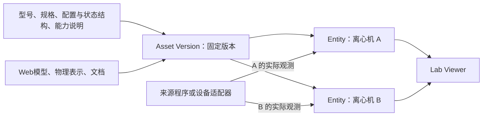

# 完整资产定义、外部编写与来源实例

状态：资产边界已在 Q10、Q14–Q16 确认，2026-10-13；字段名、接口路径和兼容迁移仍为设计草案。本文细化 [Issue #85](https://github.com/CaiZongyuan/labworld/issues/85) 的资产信息需求，不是已实现接口参考。决定见 [ADR 0014](../adr/0014-versioned-assets-and-external-authoring.md)，来源流程见[三阶段设计](newton-source-sync.md)。

## 1. 编写与运行职责

| 内容 | 编写或产生位置 | Lab World 的责任 |
| --- | --- | --- |
| 几何、材质、纹理 | Blender 或其他三维工具 | 管理表示资源，选择适用的 Web 表示并显示。 |
| 物理描述 | USD Physics、Isaac Sim/Isaac Lab 配置或 Newton ModelBuilder | 保留表示及实际采用版本的引用，不根据外观推断物理参数。 |
| 场景结构和初始布局 | Isaac Sim 场景、Isaac Lab 配置或 Newton 程序 | 导入来源场景与对象映射，来源对象先禁用编辑。 |
| 型号、规格、配置与状态结构、能力和文档 | 独立资产描述文件 | 导入、校验、发布固定版本、查询与关联；首版不新增网页编写入口。 |
| 实际运动与设备观测 | Newton 程序或未来现实设备适配器 | 接收来源明确的状态，保存及展示有效值、最后值与缺口。 |

Newton 的主要职责是构建或导入物理模型并推进求解；其 Python 程序可以装配场景和执行任务。Isaac Sim/Kit 可以提供 GUI，而物理仍由 Newton 求解；本机原 GUI 脚本采用的正是这个组合。Blender 处理外观资产，这些工具可共同参与一条资产和场景流程。

## 2. 四个不同的领域含义



| 概念 | 离心机例子 | 不混入的数据 |
| --- | --- | --- |
| Asset / Asset Version | 某型号冷冻离心机的已发布定义 | 某台设备当前正在以多少 rpm 运行。 |
| Asset Representation | 外观 GLB、仿真 USD/物理描述、说明文档 | 设备实例身份和当前任务结果。 |
| Entity / Equipment Instance | 离心机 A、离心机 B，各自的配置和来源对象 key | 另一台同型号设备的身份或运行状态。 |
| Observation 与运行记录 | A 的 speed、temperature、phase 及时间、质量、来源 | 额定最大转速或默认初始温度冒充实际测量。 |

资产保存“speed 是数值、单位为 rpm”等结构定义。实际的 `speed=4200` 属于某个 Entity 的某次来源报告，需要带时间和质量信息。没有报告时显示未知；新的连接心跳不能使旧转速变成实时值。

实验结果、操作记录与历史测量也属于具体实例或运行。资产可以描述输出数据的结构和含义，但不承载各台设备不断增长的历史值。

模拟和现实设备可复用资产定义与模型，但保留不同 Entity、Binding 和历史，沿用 ADR 0007。

## 3. 资产描述文件建议

首版可采用 JSON 描述文件。以下字段形状用于设计审阅，尚不是当前 SDK 或公开导入接口。声明的资源需要对应真实内容及校验值；示例文件名是示意。

| 字段组 | 内容与校验目的 |
| --- | --- |
| 身份与版本 | schema_version、asset_id、version；资产身份不以 GLB hash 或设备实例 key 替代。 |
| 基础资料 | 名称、类别、厂商、型号、说明、来源与许可。未知资料明确缺省，不从几何猜测。 |
| 规格 | 额定转速范围、温度范围、容量、适用转子等静态资料，附单位及来源。 |
| configuration_schema | 实例可携带哪些配置，例如初始温度或所用转子；实际配置值由实例/来源提供。 |
| state_schema | 状态属性类型、单位、枚举与含义；不存每台设备的最新值。 |
| capabilities | 能力标识、版本、参数约束、结果含义与说明；不提供“已实现/可执行”的自报许可。 |
| representations | 各表示的 key、用途、格式、精确资源引用与校验值；允许视觉、物理和文档分别表达。 |
| 依赖清单 | 所声明资源的闭包、内容 hash、尺寸和转换来源，保证发布版本引用可解析。 |

离心机信息样例：

```json
{
  "schema_version": 1,
  "asset_id": "example/centrifuge-c",
  "version": "1.0.0",
  "name": "冷冻离心机 C",
  "category": "instrument",
  "specifications": {
    "speed": { "unit": "rpm", "minimum": 0, "maximum": 15000 },
    "temperature": { "unit": "degC", "minimum": -10, "maximum": 40 }
  },
  "configuration_schema": {
    "type": "object",
    "properties": {
      "initial_temperature": { "type": "number", "unit": "degC" }
    }
  },
  "state_schema": {
    "type": "object",
    "properties": {
      "speed": { "type": "number", "unit": "rpm" },
      "temperature": { "type": "number", "unit": "degC" },
      "elapsed_seconds": { "type": "number", "unit": "s" },
      "phase": {
        "enum": ["idle", "preparing", "running", "decelerating"]
      }
    }
  },
  "capabilities": [
    {
      "id": "centrifuge.start",
      "version": "1.0",
      "parameters": {
        "rpm": { "type": "integer", "unit": "rpm" },
        "temperature": { "type": "number", "unit": "degC" },
        "duration_seconds": { "type": "integer", "unit": "s" }
      },
      "result_meaning": "task_started"
    }
  ],
  "representations": [
    { "key": "web", "purpose": "visual", "resource": "model.glb" },
    { "key": "physics", "purpose": "simulation", "resource": "model.usd" },
    { "key": "manual", "purpose": "documentation", "resource": "manual.pdf" }
  ]
}
```

此处数值和四个状态字段取自现有内置离心机定义，示例型号名和资源引用为示意。完整导入需要补齐资源校验值、来源资料和能力参数限制；本例没有宣称外部离心机模型、文档或遥测入口已经存在。`unit` 等注解的正式格式及验证方式需与现有状态合同统一。

一个表示可以由多个资源共同构成。SO-101 的 Web 表示需要声明各连杆的 component key、局部原点及资源引用，再由场景映射到多个可视根；七个连杆仍属于一个机器人 Asset 和一个整机 Entity。组件 key 属于资产表示，源程序的实际 prim/body path 属于该场景的映射，二者不能合并成全局实例身份。

额定规格、实例配置和实际观测用途不同。额定最大转速不是当前转速；初始温度配置也不能替代来源报告的实际温度。物理求解器未产生或程序未上报的业务状态保持未知，不能因存在离心机模型就启动另一套内置数据来补值。

能力存在可作为资产说明；本次来源模式没有设备动作执行入口，Binding 及执行许可必须明确表达只读。能力参数的限制与遥测值的类型/质量校验也需要分别实现，不能把真实超额定报告改写成额定值。

## 4. 场景只引用资产，实例保留独立 key

外部场景需要保留以下关联，字段名仍为草案：

```json
{
  "objects": [
    {
      "object_key": "centrifuge-a",
      "asset_ref": { "id": "example/centrifuge-c", "version": "1.0.0" },
      "visual_representation": "web",
      "physics_representation": "physics"
    },
    {
      "object_key": "centrifuge-b",
      "asset_ref": { "id": "example/centrifuge-c", "version": "1.0.0" },
      "visual_representation": "web",
      "physics_representation": "physics"
    }
  ]
}
```

两个对象引用同一资产版本，但分别登记 Entity，并分别接收配置、观测与任务信息。Scene Node 和物理字典进一步引用各自的 object key；不能用共享的 asset_id、网格名或资源 hash 作为实例身份。

USD customData、assetInfo、自定义属性，或源程序的配置文件可承载这些引用。完整业务定义使用独立描述文件，避免把复杂 schema 重复复制到每个网格。Q13 已确认，未声明业务资产引用时可作为通用模型导入，类别和能力未知；已声明引用却找不到精确版本时报告失败，不能猜测成某台或某型号离心机，也不能静默降级隐藏错误。

## 5. 版本与导入过程

建议通过一个完整资产导入接口准备描述文件与表示资源，返回可解析的精确资产版本和各表示引用。调用方不用分别拼接设备定义、GLB 资产、文件 pin 和运行绑定。场景导入再解析资产版本，登记实例与来源映射；逐帧发布只使用已经固定的对象字典。

作者准备资产描述文件并在场景中声明引用；适配器可以自动提交所需描述及资源，复用 Lab World 已登记的相同版本。首次准备资料发生在外部资产编写流程，来源接入时不要求用户再逐个上传或登记对象。只携带资产引用时，Server 必须能解析精确版本；版本缺失或内容冲突报告明确失败。

| 步骤 | 行为与不变量 |
| --- | --- |
| 准备 | 检查描述、引用与所声明资源，上传缺少内容；来源同步的新资源按 Q12 暂存，失败可重试，成功后发布。 |
| 验证 | 校验结构、单位、状态字段、资源闭包及表示用途；资源可保存与后端实际支持该物理格式分别表达。 |
| 发布 | 固定定义和资源引用，登记 Asset Version；同 ID/版本/内容可幂等复用，不同内容不能覆盖原版本。 |
| 场景采用 | 用精确版本及表示引用登记实例；配置和最新观测属于实例。 |
| 升级 | 新定义、状态结构或模型发布新版本；通过场景差异显式采用，历史继续引用旧版。 |

几何相同的不同型号可以复用资源字节，但不因此合并资产身份。资产或文件的移除只能释放自己的引用；场景及 Recording 保留的旧版本与所用资源仍需可解析。

Q11 已确认来源移除对象只移除来源可视节点，保留 Entity 与历史，归档单独确认。Q12 的取消清理只处理无其他消费者的暂存资源；已发布 Asset Version 和被实例/录制保留的依赖不因此删除。

资产发布的权限与场景来源维护权限分开约束。实施默认给来源配置限定的资产发布命名空间，来源只发布其获准空间内的新版本；其他共享资产只使用已获准的精确引用。组织资产可由现有 full-access 用户/Agent 单独导入。来源凭据不继承用户/Agent 的整个 Lab 修改权，也不能覆盖已发布版本或其他来源对象。

同 ID/版本/内容重复提交返回原版本，不同内容返回版本冲突；不以顺手递增版本或重命名隐藏冲突。正式路径、错误码和迁移在实现中与现有合同统一，这是工程默认，不新增成员角色。

## 6. 源侧元数据的已验证入口

本机只读调查和独立临时小文件验证得到以下事实：

- USD Flatten 保留 customData、assetInfo 和 custom attributes。
- Blender 的自定义属性导入与 GLB export_extras 可以保留明确写入的资产引用、版本和实例 key。
- customData/assetInfo 不会自动进入该 Blender 到 GLB 链路，需要适配器主动提取并写入映射或 sidecar。
- 两个相同 Cube 的小测试成功保留共同 asset key/version 和不同 object key；不代表复杂设备 schema 或完整场景转换已经验证。临时产物和进程已清理。
- Newton CustomAttribute 可以承载显式声明的 body/shape 属性，但不会从几何推断厂商型号、设备能力或业务状态结构。
- 原 SO-101 场景目前没有 Lab 资产引用，需要增加源侧描述或映射配置。

复杂设备定义因此从描述文件导入。转换器保证引用和原点映射可追溯；定义登记不依赖 GLB extras 是否保留全部业务信息。

## 7. 当前实现与消费者影响

代码基线：`9e0f1040608f5c40d7e7b33f9c0b099b32ed88b5`。本次候选为设计文档与术语变更，没有生产接口或数据库迁移。下表为代码阅读证据；源侧小型转换证据的实际范围见上节。

当前存在两条链：静态 catalog 的 AssetDefinition 固定到 Entity 定义快照；GLB LabAsset 的唯一 Representation 引用到 Entity/Scene Node。LabAsset 本身没有 definition 关联，多表示也未实现。完整 Asset 是现有领域目标，需要建设正式关联与版本，而非仅新增几个 GLB metadata 字段。

| 受影响合同 | 真实消费者与当前事实 | 需要保留或新增的验证 |
| --- | --- | --- |
| 完整定义与模型关联 | [AssetDefinition](../../packages/server/src/lab/world/domain.ts)、[GLB Asset](../../packages/server/src/lab/assets/domain.ts)当前分开；[schema](../../packages/server/src/lab/assets/schema.ts)一资产一表示。 | 新版本能关联多用途表示；既有纯 GLB 与 catalog 定义仍能准确读取和追溯。 |
| World 与 SDK | [World](../../packages/server/src/lab/world/use-cases.ts)返回实际引用资产及 Entity 定义快照；[SDK](../../packages/sdk/src/generated/sdk.gen.ts)有分开的两套列表合同。 | 不因改统一列表而丢模型、定义快照或未列在第一页的引用。 |
| 定义与运行绑定 | [登记](../../packages/server/src/lab/world/entities.ts)会给模拟 light/sensor/centrifuge 自动创建内置程序 Binding。 | 来源对象可引用离心机信息定义，并绑定外部只读来源；不创建错误的内置来源和执行许可。 |
| 状态与能力展示 | [观测](../../packages/views/src/lab/observation-state.ts)依据定义结构、来源、当前 Binding/Run 与质量判断；[离心机界面](../../packages/views/src/lab/centrifuge-panel.tsx)有专门实现。 | 结构化状态字段可查看，缺值为未知；单向来源无控制执行入口。 |
| 模型与运动 | [Viewer](../../packages/views/src/lab/world-viewport.tsx)按表示加载；离心机内置转子与导入 GLB 的映射不同。 | 多表示选择正确；导入离心机没有转子映射时，不据数据假定内部模型已经可动画。 |
| 录制与资源 | [Recording](../../packages/server/src/lab/recordings/service.ts)保存定义/配置/绑定快照，资源收集当前仅遍历单 representation。 | 新资产版本的实际所用表示与依赖被正式保留，删除当前资产不改写旧录制。 |
| 定义/外观升级 | [生命周期](../../packages/server/src/lab/world/lifecycle.ts)分别处理定义与外观，定义升级需空闲。 | 明确版本采用与来源权限；不让共享资产更新自动改写正在观察的实例。 |

仅导入设备描述不会实现新的设备程序、测量协议或控制执行。外部设备状态的通用接入仍需第三阶段合同，不能将已有内置离心机行为当作 Newton 离心机的数据来源。

## 8. 实施与验证

资产发布通过限定命名空间及固定版本约束；状态字段依据明确 schema 和源侧映射显示，未报告保持未知。第三阶段的起点、生命周期、段间缺口及来源结果已在 Q17–Q22 确认，见[实时观察合同](newton-live-observation-contract.md)。

实施仍需验证完整设备描述文件、复杂 schema、多用途资源及消费者兼容。此前两个 Cube 的引用传递是小型事实证据，不能替代离心机完整信息导入、状态读取或整场景端到端验证。
